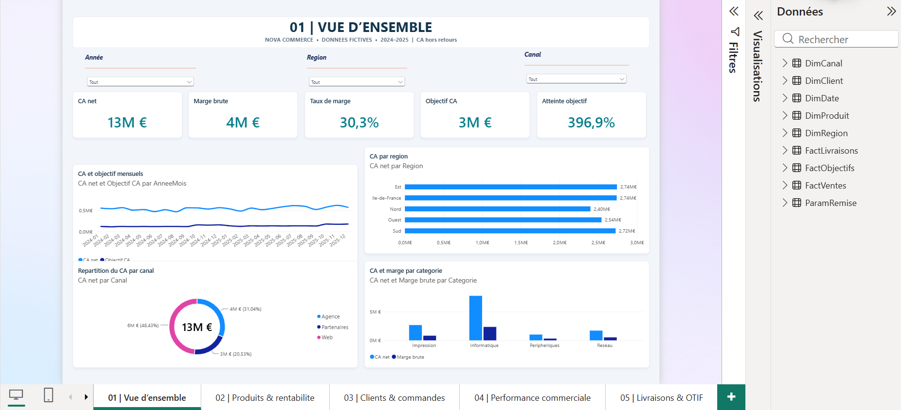

# 📊 Power BI — Sales & Supply Chain Analytics

Ce dépôt regroupe un projet décisionnel et analytique complet réalisé avec **Microsoft Power BI**, appliqué au cas d'usage d'une entreprise de distribution commerciale (**NOVA COMMERCE**).

L’objectif est de fournir un tableau de bord interactif d'aide à la décision permettant de piloter simultanément la **performance commerciale**, la **rentabilité financière**, le **suivi des objectifs** et l'**efficacité logistique (Supply Chain / OTIF)**.

---

## 📑 Sommaire
- [Tableaux de bord & Visualisations](#-tableaux-de-bord--visualisations)
  - [1. Vue d'ensemble (Synthèse de Direction)](#1-vue-densemble--synthèse-de-direction)
  - [2. Clients & Commandes](#2-clients--commandes)
  - [3. Livraisons & Performance Supply Chain (OTIF)](#3-livraisons--performance-supply-chain-otif)
- [Modèle de données & Schéma en étoile](#-modèle-de-données--schéma-en-étoile)
- [Organisation des Mesures DAX](#-organisation-des-mesures-dax)
- [Jeux de données & Architecture](#-jeux-de-données--architecture)
- [Compétences mises en pratique](#-compétences-mises-en-pratique)
- [Consultation du rapport](#-consultation-du-rapport)

---

## 🖥️ Tableaux de bord & Visualisations

### 1. Vue d'ensemble (Synthèse de Direction)
Ce tableau de bord offre une synthèse macro-économique des performances de l'entreprise (2024–2025) :
* **KPIs stratégiques** : Chiffre d'affaires net (**13M €**), Marge brute (**4M €**), Taux de marge moyen (**30,3%**), Objectif commercial (**3M €**) et Taux d'atteinte (**396,9%**) ;
* **Analyse temporelle** : Évolution mensuelle comparée du CA net face aux objectifs budgétaires ;
* **Ventilation multidimensionnelle** : Performance par région commerciale (Est, Île-de-France, Nord, Ouest, Sud), répartition par canal de vente (Web, Agence, Partenaires) et rentabilité par catégorie de produits (Informatique, Impression, Périphériques, Réseau).



---

### 2. Clients & Commandes
Cette page analyse en profondeur la structure de la clientèle, les comportements d'achat et le portefeuille commercial :
* **Indicateurs clés** : Nombre de clients actifs (**180**), volume de commandes (**1 448**), panier moyen (**1 891 €**), chiffre d'affaires moyen par client (**15K €**) et fréquence d'achat (**8,0 commandes/client**) ;
* **Segmentation client** : Répartition du CA par profil (Éducation, Grands comptes, Particuliers, PME) ;
* **Dynamique d'engagement** : Suivi mensuel de la volumétrie des clients actifs et répartition des commandes selon le canal de distribution ;
* **Détail du portefeuille** : Table matricielle détaillée des clients avec CA généré, fréquence de commande et valeur du panier moyen.


---

### 3. Livraisons & Performance Supply Chain (OTIF)
Un tableau de bord orienté logistique et qualité de service, fondé sur l'indicateur international **OTIF** (*On-Time In-Full*) :
* **Indicateurs de service** : Taux OTIF global (**64,8%** vs objectif cible pédagogique de **95%**), taux de ponctualité *On Time* (**70,0%**), taux de complétude *In Full* (**89,3%**) et *Fill Rate* (**94,9%**) ;
* **Analyse des dysfonctionnements** : Suivi des commandes non conformes (**2 530**) et retard moyen constaté (**13,9 jours**) ;
* **Diagnostic & causes d'échec** : Répartition des anomalies logistiques (retards, commandes incomplètes, reliquats/en attente) ;
* **Matrice territoriale** : Comparaison du taux de service et des retards selon les régions et canaux de distribution.


---

## 🧩 Modèle de données & Schéma en étoile

Le modèle relationnel a été conçu selon les règles de l'art du décisionnel sous un **schéma en étoile (Star Schema)** garantissant des performances optimales et une clarté dans la propagation des filtres :


### Architecture relationnelle
* **Tables de dimensions (1)** :
  * `DimClient` : données signalétiques, typologie et segmentation ;
  * `DimProduit` : hiérarchie catalogue, familles et prix de référence ;
  * `DimRegion` : organisation territoriale et secteurs commerciaux ;
  * `DimCanal` : circuits de distribution (Direct/Agence, Partenaires, Web) ;
  * `DimDate` : calendrier continu, gestion des granularités temporelles et Time Intelligence.
* **Tables de faits (*)** :
  * `FactVentes` : transactions de vente détaillées (quantités, montants bruts, remises, coûts, marges) ;
  * `FactLivraisons` : expéditions, dates d'engagement vs dates réelles, statut OTIF ;
  * `FactObjectifs` : cibles budgétaires par canal, région et période.
* **Paramètres** :
  * `ParamRemise` : scénarios et simulation de sensibilité aux remises commerciales.

---

## 📐 Organisation des Mesures DAX

Pour assurer la maintenabilité et la lisibilité du modèle, les calculs DAX sont centralisés et structurés dans des **dossiers d'affichage (Display Folders)** thématiques :


* `01 Synthese` : Mesures fondamentales de pilotage (`CA net`, `Marge brute`, `Taux de marge`, `Objectif CA`, `Atteinte objectif`) ;
* `02 Produits` : Analyses de marge unitaire, prix moyen et mix produit ;
* `03 Clients` : Métriques client (panier moyen, valeur vie, fréquence d'achat) ;
* `04 Performance` : Ratios de croissance et comparaisons N vs N-1 ;
* `05 Service & OTIF` : Calculs de service logistique (`OTIF %`, `On Time %`, `In Full %`, `Fill rate %`, `Retard moyen`) ;
* `06 Classements & Pareto` : Rangs dynamiques, top N et analyse ABC ;
* `07 Temps & simulation` : Fonctions d'intelligence temporelle (`YTD`, `SAMEPERIODLASTYEAR`) et tables de paramètres `What-If`.

---

## 📁 Contenu du dépôt

| Fichier / Dossier | Description |
| :--- | :--- |
| `powerbi-sales-supplychain-analytics.pbix` | Rapport Power BI Desktop interactif complet avec modèle, DAX et visuels |
| `Donnees_CSV/` | Données sources tabulaires (Dimensions, Faits et Paramètres) |
| `images/` | Captures d'écran haute définition des pages du rapport, du modèle et des mesures |
| `README.md` | Présentation documentée du projet |

---

## 🛠️ Compétences mises en pratique

* **ETL & Préparation de données (Power Query)** : Nettoyage, standardisation des types, fusion de clés et transformations de données ;
* **Modélisation dimensionnelle (Star Schema)** : Structuration en tables de faits et de dimensions, relations 1-à-plusieurs, direction de filtre unidirectionnelle ;
* **Calculs & Logique DAX** : Mesures d'agrégation, calculs de ratios complexes, fonctions de Time Intelligence (`SAMEPERIODLASTYEAR`, `YTD`), filtres de contexte (`CALCULATE`, `FILTER`, `USERELATIONSHIP`) ;
* **Data Visualisation & Storytelling** : Conception d'interfaces épurées et intuitives, cartes KPI, jauges d'objectifs, graphiques combinés et ergonomie de navigation ;
* **Analyse Métier Ventes & Supply Chain** : Modélisation des indicateurs de rentabilité commerciale et du taux de service logistique (OTIF).

---

## 🚀 Consultation du rapport

1. Télécharger et installer **[Microsoft Power BI Desktop](https://powerbi.microsoft.com/desktop/)** ;
2. Cloner le dépôt :
   ```bash
   git clone https://github.com/hctsamyUCT/powerbi-sales-supplychain-analytics.git
   ```
3. Ouvrir le fichier `powerbi-sales-supplychain-analytics.pbix` dans Power BI Desktop ;
4. Si nécessaire, réajuster le chemin des sources de données locales vers le dossier `Donnees_CSV/` (*Transformer les données > Paramètres de la source de données*) ;
5. Cliquer sur **Actualiser**.